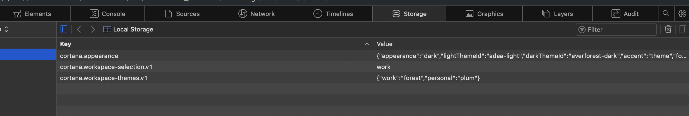
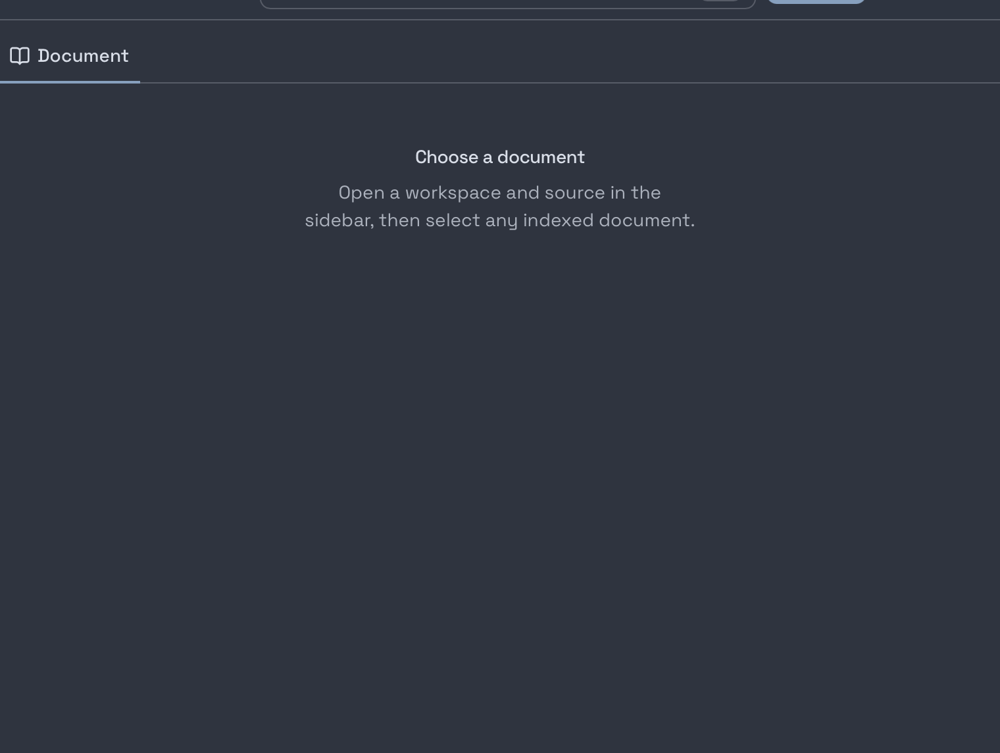
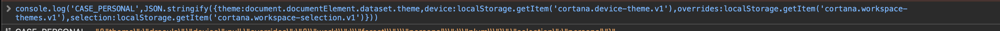
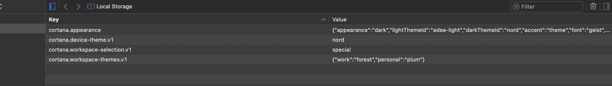
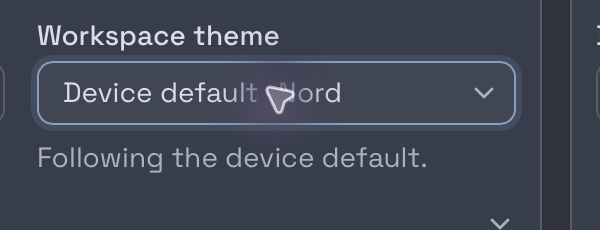
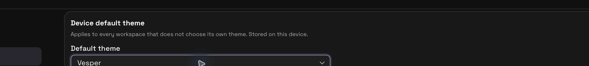
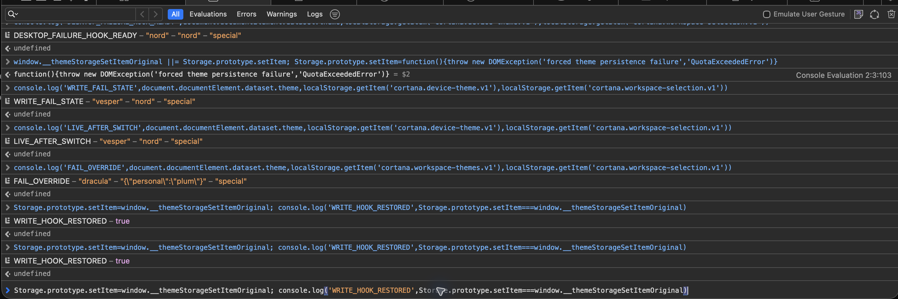

# PR #2573: packaged macOS desktop persistence verification

## Build identity

- PR source tested: `8b6dabc11e4e0830a87c61ccf8660d3b1a18e025` (`claude/device-default-theme` at test time).
- Evidence is added in a documentation-only commit; the tested application sources and build remain the pinned commit above.
- Host: macOS 26.7.1, arm64. App version: `0.68.4`; installation type: packaged macOS Tauri app.
- Interactive run: debug `.app`, bundle ID `ai.cortana.desktop.verify2573`, using native WKWebView.
- App executable SHA-256: `cbd33ac339d58284888173bbfd8192e5472ed7b66a013be34df92fd84c79a6b9`.
- Tauri sidecar SHA-256: `6077c1694d6e141f41dced589086b120aa34ebd0ba0511ebb4034841056c9364`.
- Release `.app` was also built from the pinned source; executable SHA-256: `d7fd0f2f16978d8125d51ed7d3e12022a1ce3ed1d67cf073cf1387fd62c214e4`. Interactive cases were run on the packaged debug app.

## Results

| Acceptance case                                                            | Result                                                                                                                                                                                                                                                                                                     | Evidence                                                                                                                                                                  |
| -------------------------------------------------------------------------- | ---------------------------------------------------------------------------------------------------------------------------------------------------------------------------------------------------------------------------------------------------------------------------------------------------------- | ------------------------------------------------------------------------------------------------------------------------------------------------------------------------- |
| Preserve legacy entries on first launch                                    | **PASS** — `cortana.workspace-themes.v1` began as `{"work":"forest","personal":"plum"}`; selection was `work`; no device-theme key was created.                                                                                                                                                            |                                                                                                                   |
| Device default persists through full quit and relaunch                     | **PASS** — after setting Nord, quitting the process, and relaunching, the remembered workspace rendered with `data-theme=nord` on its first frame.                                                                                                                                                         |                                                                                       |
| Workspace overrides take precedence                                        | **PASS** — with device default Nord, the live `work` theme resolved to Everforest Dark; Personal resolved to Dracula.                                                                                                                                                                                      |                                                                                          |
| Workspace switching applies the correct theme                              | **PASS** — switching between workspaces updated the active theme to the override or device fallback for the selected workspace.                                                                                                                                                                            |                                                                                                  |
| Existing legacy entries stay unchanged                                     | **PASS** — changing the device default left the map exactly `{"work":"forest","personal":"plum"}`. Clearing the work override removed only that key, retaining Personal’s `plum`.                                                                                                                          |                                                                                              |
| Clearing an override restores the device default                           | **PASS** — the selector displayed “Device default · Nord” and “Following the device default”; returning to work applied Nord.                                                                                                                                                                              |                                                                                                    |
| Failed writes keep selector and active theme consistent during the session | **PASS** — under a `QuotaExceededError`, the device selector and active theme both showed Vesper. A failed workspace override kept the selector and active theme at Dracula while persisted storage remained unchanged; after restoring native storage and relaunching, the session-only values were gone. |   |

The persisted device-default value and current selection were visible in native WebKit Local Storage:

## Scope and limitations

This was a real packaged Tauri/WKWebView run. No Chromium or mocked Tauri bridge substituted for it. The write-failure case replaced `Storage.prototype.setItem` inside the real WKWebView with a function throwing `QuotaExceededError`; this exercises the app’s session fallback but does not simulate a full disk or corrupt WebKit database.

The test app used the separate bundle ID `ai.cortana.desktop.verify2573`. The installed app and normal bundle storage were not launched or modified. No credentials or configuration were changed, and no production data mutation was made; startup read workspace/index metadata. No production source was changed, and no theme defect was observed.

A WebKit `ResizeObserver loop completed with undelivered notifications` warning appeared while using the docked inspector. It did not coincide with theme actions or change any assertion result; it was not attributed to this change.

The first-paint capture is cropped to the content canvas to avoid publishing the user’s workspace label or source metadata. The full private capture remains local for audit.
